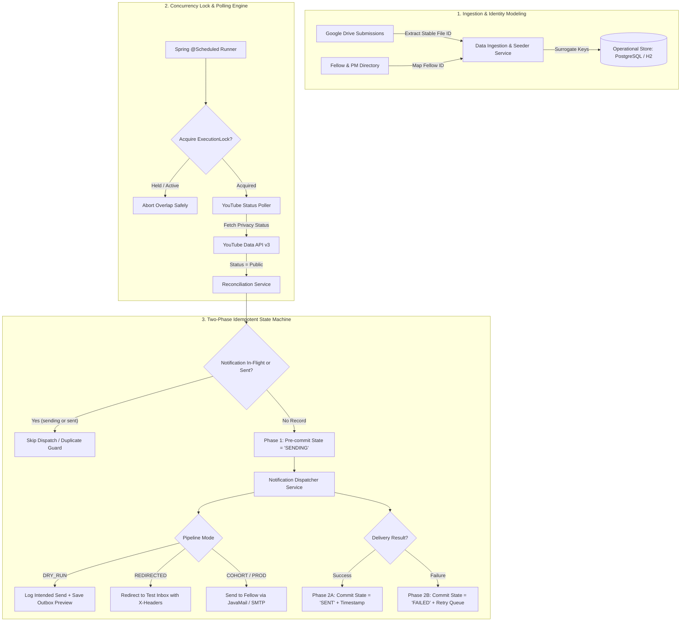

<div align="center">

# Automated Publication-Notification Pipeline
### Humanitarians AI &bull; Content Operations & Workflow Automation (Java / Spring Boot Edition)

[](https://www.oracle.com/java/)
[](https://spring.io/projects/spring-boot)
[](https://www.postgresql.org/)
[](https://junit.org/junit5/)
[](https://flywaydb.org/)
[](#architecture--system-design)
[](LICENSE)

An idempotent, production-grade Spring Boot backend that automates creator publication notifications by reconciling Google Drive submissions, relational video registers, and YouTube Data API publication events with strict concurrency controls and zero duplicate delivery guarantees.

</div>

---

## 📌 Problem & Motivation

At **Humanitarians AI**, educational fellows produce videos that are reviewed by editorial teams and uploaded as drafts to YouTube playlists (`Queue`). When reviewers publish videos to the public, fellows must be promptly notified with their live publication URL.

### The Engineering Challenges:
1. **Ambiguous Identifier Matching**: Submissions arrived via Google Drive with raw filenames (e.g., `Caching_Explainer_Final.mp4`), but YouTube titles were rewritten for audience SEO (e.g., `Caching Explained in 5 Minutes`). Matching by title or filename was brittle, producing silent misses or incorrect mappings.
2. **Duplicate Email Risks**: Scheduled cron polling repeatedly checks video availability. Without strict idempotency guards, overlapping executions or mid-pipeline retries risked spamming external fellows.
3. **Operational Silos**: Review events, draft uploads, and fellow email directories existed across disconnected spreadsheets without relational integrity or transactional audit logging.

---

## 🏗️ Architecture & System Design

The pipeline replaces brittle string matching with an **explicit relational identifier model** and an **idempotent two-phase state machine**:



---

## 💾 Relational Data Model (Spring Data JPA / Flyway)

Managed via Flyway versioned migrations (`V1__initial_schema.sql`) and Jakarta Persistence (`@Entity`) with foreign keys, composite indexes, and database check constraints:

```mermaid
erDiagram
    PROJECTS ||--o{ FELLOWS : contains
    PROJECTS ||--o{ PMS : manages
    FELLOWS ||--o{ VIDEOS : authors
    VIDEOS ||--o{ REVIEW_EVENTS : logs
    VIDEOS ||--o{ NOTIFICATIONS : tracks

    PROJECTS {
        int project_id PK
        string project_name
        string project_type
    }

    PMS {
        int pm_id PK
        int project_id FK
        string full_name
        string email
        string role
        string status "CHECK ('active', 'inactive')"
    }

    FELLOWS {
        int fellow_id PK
        int project_id FK
        string full_name
        string email
        string status "CHECK ('active', 'inactive')"
        string display_label
    }

    VIDEOS {
        int video_id PK
        int fellow_id FK
        string title
        string youtube_link
        string drive_link
        string drive_file_id
        string youtube_video_id "INDEX"
        string current_status "INDEX, CHECK ('submitted','in_review','needs_modification','queued','published')"
        text status_note
        timestamp submitted_on
        timestamp published_on
    }

    REVIEW_EVENTS {
        int event_id PK
        int video_id FK
        string event_type "CHECK ('submitted','review_started','modification_requested','resubmitted','approved','queued','published')"
        string reviewer
        timestamp occurred_on
        text notes
    }

    NOTIFICATIONS {
        int notification_id PK
        int video_id FK
        string recipient_email
        timestamp sent_on
        string delivery_status "INDEX, CHECK ('pending','sending','sent','failed','skipped')"
        text reason
        int attempt_count
    }
```



---

## 🛡️ Reliability & Enterprise Guarantees

### 1. Cross-Process Mutual Exclusion (`ExecutionLockService`)
To prevent concurrent scheduled executions from colliding:
* Acquires a file-backed mutex capturing `pid`, `hostname`, and `timestamp`.
* Overlapping triggers raise `LockAcquisitionException` and abort immediately.
* **Automatic Stale-Lock Reclamation**: Expired locks exceeding the TTL (default: 600s) are automatically reclaimed to prevent deadlocks caused by killed containers.

### 2. Two-Phase Commit Delivery State Machine
* **Phase 1**: Prior to making external HTTP/SMTP calls, the pipeline commits a record with `delivery_status = 'SENDING'`.
* **Phase 2**: If the process crashes mid-network call, the record remains visible in the audit log as `SENDING`. The next run detects the in-flight record and refuses to double-send, trading an invisible failure for a visible, auditable record.
* Upon confirmed dispatch, the status is updated to `SENT` with an UTC delivery timestamp.

### 3. Four-Stage Rollout Engine
| Mode | Behavior | Purpose |
| :--- | :--- | :--- |
| **`DRY_RUN`** | Simulates logic and renders `.html`/`.json` outbox previews without dispatching emails. | Validates state transitions and fellow resolutions locally. |
| **`REDIRECTED`** | Formats emails but redirects to a test address, preserving `X-Original-Recipient`. | Verifies visual template layout in a live email inbox. |
| **`COHORT`** | Filters recipients against a strict canary whitelist (`COHORT_FELLOW_IDS`). | Enables limited production rollout for early feedback. |
| **`PROD`** | Live end-to-end delivery to verified active fellow emails. | Full organization rollout. |

### 4. Operational Health Diagnostics (`PipelineHealthService` & `NotificationRetryService`)
* **Pipeline Doctor**: Detects stranded `SENDING` jobs (>10m), orphaned videos without fellow records, and fellows with invalid emails.
* **Automated Retry Service**: Queries transient failures and re-attempts delivery with exponential backoff up to 3 attempts.

---

## 🚀 Quickstart & Setup

### Prerequisites
- **Java 17 LTS** (Amazon Corretto or OpenJDK 17+)
- **Apache Maven 3.9+**

### 1. Clone & Build
```bash
git clone https://github.com/aks2161989/java-notification-pipeline.git
cd java-notification-pipeline

# Build and package executable JAR
mvn clean package
```

### 2. Run the Application
```bash
# Run using Spring Boot Maven plugin
mvn spring-boot:run

# Or run the packaged JAR directly
java -jar target/notification-pipeline-1.0.0.jar
```

### 3. Configuration (`application.yml` or Environment Variables)
```yaml
pipeline:
  mode: ${PIPELINE_MODE:DRY_RUN} # DRY_RUN, REDIRECTED, COHORT, PROD
  redirect-test-email: ${REDIRECT_TEST_EMAIL:akshaychavan20031@gmail.com}
  cohort-fellow-ids: ${COHORT_FELLOW_IDS:1}
  use-mock-apis: ${USE_MOCK_APIS:true}
  youtube-api-key: ${YOUTUBE_API_KEY:}
  outbox-dir: ${OUTBOX_DIR:outbox}
  lock-timeout-seconds: ${LOCK_TIMEOUT_SECONDS:600}
```

---

## 🕹️ Operational REST API

The application exposes endpoints for operations and lifecycle testing:

### 1. Trigger Reconciliation Run
```bash
# Run reconciliation in DRY_RUN mode
curl -X POST "http://localhost:8080/api/pipeline/reconcile?mode=DRY_RUN"

# Run reconciliation in REDIRECTED mode
curl -X POST "http://localhost:8080/api/pipeline/reconcile?mode=REDIRECTED&redirectTo=test@example.com"
```

### 2. Pipeline Health & Metrics
```bash
# Operational metrics dashboard
curl http://localhost:8080/api/pipeline/status

# Diagnostic health check (detects stranded jobs & retry exhaustion)
curl http://localhost:8080/api/pipeline/health
```

### 3. Retry Failed Notifications
```bash
curl -X POST "http://localhost:8080/api/pipeline/retry?maxAttempts=3"
```

### 4. Seed Database
```bash
# Seed from synthetic test matrix
curl -X POST "http://localhost:8080/api/pipeline/seed?syntheticOnly=true"

# Seed from master tracker spreadsheet (data/YouTube_Pipeline_Tracker.xlsx)
curl -X POST "http://localhost:8080/api/pipeline/seed?syntheticOnly=false"
```

### 5. Simulate Reviewer Publication
```bash
# Simulate reviewer publishing Video 1 on YouTube
curl -X POST "http://localhost:8080/api/pipeline/simulation/publish/RzW17zhV4Nw"

# Simulate unpublishing
curl -X POST "http://localhost:8080/api/pipeline/simulation/unpublish/RzW17zhV4Nw"
```

---

## 🧪 Automated Test Suite

Run the full JUnit 5 and Mockito test suite:

```bash
mvn test
```

```
[INFO] -------------------------------------------------------
[INFO]  T E S T S
[INFO] -------------------------------------------------------
[INFO] Running ai.humanitarians.pipeline.adapter.AdaptersTest
[INFO] Tests run: 6, Failures: 0, Errors: 0, Skipped: 0
[INFO] Running ai.humanitarians.pipeline.service.DataNormalizerTest
[INFO] Tests run: 5, Failures: 0, Errors: 0, Skipped: 0
[INFO] Running ai.humanitarians.pipeline.service.ExecutionLockServiceTest
[INFO] Tests run: 2, Failures: 0, Errors: 0, Skipped: 0
[INFO] Running ai.humanitarians.pipeline.service.ReconciliationServiceTest
[INFO] Tests run: 2, Failures: 0, Errors: 0, Skipped: 0
[INFO] Running ai.humanitarians.pipeline.service.RecoveryServiceTest
[INFO] Tests run: 3, Failures: 0, Errors: 0, Skipped: 0
[INFO] Running ai.humanitarians.pipeline.service.DatabaseSeederServiceTest
[INFO] Tests run: 2, Failures: 0, Errors: 0, Skipped: 0
[INFO] 
[INFO] Results:
[INFO] Tests run: 20, Failures: 0, Errors: 0, Skipped: 0
[INFO] ------------------------------------------------------------------------
[INFO] BUILD SUCCESS
```

---

## 📂 Project Structure

```
java-notification-pipeline/
├── pom.xml                                  # Maven dependencies & build plugins
├── data/
│   └── YouTube_Pipeline_Tracker.xlsx        # Master reference spreadsheet
├── docs/
│   └── INTERVIEW_CHEAT_SHEET.md             # System design talking points & interview guide
├── src/
│   ├── main/
│   │   ├── java/ai/humanitarians/pipeline/
│   │   │   ├── PipelineApplication.java     # Spring Boot application entrypoint
│   │   │   ├── config/                      # Properties and adapter configurations
│   │   │   ├── controller/                  # Operational REST endpoints
│   │   │   ├── model/
│   │   │   │   ├── dto/                     # DTO records & report definitions
│   │   │   │   ├── entity/                  # JPA entities (Project, Fellow, VideoRecord, etc.)
│   │   │   │   └── enums/                   # Status enums & attribute converters
│   │   │   ├── repository/                  # Spring Data JPA repositories
│   │   │   ├── scheduler/                   # Scheduled cron runner
│   │   │   ├── service/                     # Business logic services
│   │   │   └── adapter/                     # Google YouTube, Google Drive, Email sinks
│   │   └── resources/
│   │       ├── application.yml              # Configuration settings
│   │       └── db/migration/
│   │           └── V1__initial_schema.sql   # Flyway PostgreSQL DDL migration
│   └── test/
│       ├── java/ai/humanitarians/pipeline/  # JUnit 5 & Mockito test suites
│       └── resources/
│           └── application-test.yml         # In-memory H2 test configuration
└── LICENSE                                  # MIT License
```

---

## 📄 License
This project is licensed under the MIT License - see the [LICENSE](LICENSE) file for details.
